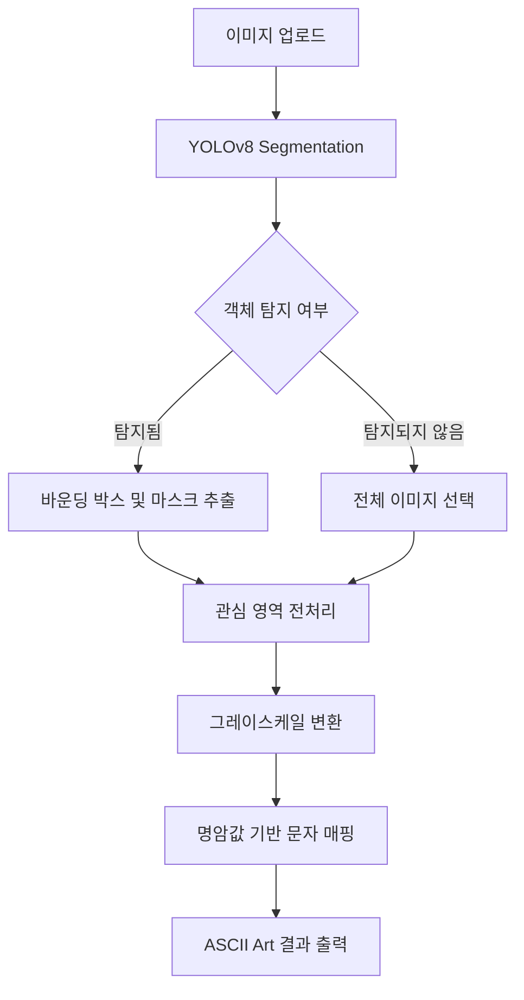

# 🖼️ Image to ASCII Art
### YOLOv8 Segmentation 기반 이미지 분석 및 아스키 아트 변환 웹 애플리케이션

## 📌 프로젝트 소개

**Image to ASCII Art**는 사용자가 업로드한 이미지에서 객체를 탐지하고, 탐지 결과를 활용해 이미지를 전처리한 뒤 ASCII Art(아스키 아트)로 변환하는 웹 애플리케이션입니다.

Python 기반의 Flask 웹 서버와 YOLOv8 Segmentation 모델을 활용하여 이미지 내 객체의 영역을 추출하고, OpenCV와 NumPy를 이용해 이미지 처리 및 문자 변환 과정을 구현했습니다.

단순한 객체 탐지에 그치지 않고, **딥러닝 기반 객체 세그멘테이션과 전통적인 이미지 처리 기법을 결합하여 시각적 결과물을 생성하는 것**을 목표로 합니다.

## ✨ 주요 기능

- **이미지 업로드:** 웹 인터페이스를 통한 이미지 입력
- **객체 탐지 및 세그멘테이션:** YOLOv8 Segmentation 모델을 이용한 객체 영역 분석
- **관심 영역 추출:** 탐지된 객체의 바운딩 박스를 기준으로 이미지 영역 추출
- **마스크 기반 이미지 처리:** 세그멘테이션 마스크를 활용한 객체 영역 처리
- **그레이스케일 변환:** 명암 정보를 활용하기 위한 흑백 이미지 변환
- **ASCII Art 생성:** 픽셀의 밝기를 문자에 대응시켜 텍스트 기반 이미지 생성
- **전체 이미지 처리:** 객체가 탐지되지 않는 경우 전체 이미지를 대상으로 변환 수행

## 🔄 처리 파이프라인



### 처리 과정

1. **이미지 입력:** 사용자가 웹 페이지에서 이미지를 업로드합니다.
2. **객체 분석:** YOLOv8 Segmentation 모델로 이미지 내 객체와 해당 영역을 분석합니다.
3. **영역 추출:** 객체가 탐지되면 바운딩 박스와 세그멘테이션 마스크를 활용해 관심 영역을 추출합니다.
4. **이미지 전처리:** 추출한 영역을 그레이스케일 이미지로 변환합니다.
5. **문자 매핑:** 이미지의 밝기 정보를 문자 집합에 대응시켜 ASCII Art를 생성합니다.
6. **결과 확인:** 변환된 결과를 웹 페이지에서 확인합니다.

객체가 탐지되지 않은 경우에는 전체 이미지를 대상으로 후속 이미지 처리 과정을 진행하도록 구현했습니다.

## 🛠️ 기술 스택

| 구분 | 기술 | 활용 목적 |
|---|---|---|
| 프로그래밍 언어 | Python | 서버 및 이미지 처리 로직 구현 |
| 웹 프레임워크 | Flask | 웹 서버 및 HTTP 요청 처리 |
| 딥러닝 모델 | YOLOv8 Segmentation | 객체 탐지 및 영역 분할 |
| 이미지 처리 | OpenCV | 이미지 변환 및 전처리 |
| 수치 연산 | NumPy | 픽셀 데이터 및 배열 처리 |
| 프런트엔드 | HTML, CSS, JavaScript | 사용자 인터페이스 구현 |
| 템플릿 엔진 | Jinja2 | Flask와 HTML 템플릿 연동 |

## 🧠 핵심 구현 내용

### 1. YOLOv8 기반 객체 세그멘테이션

객체의 위치만 확인하는 것이 아니라 세그멘테이션 결과를 활용하여 객체의 영역을 구분할 수 있도록 구성했습니다.

- 이미지 입력 및 모델 추론
- 객체별 바운딩 박스 활용
- 세그멘테이션 마스크를 이용한 영역 처리
- 탐지 결과에 따른 이미지 처리 경로 분기

프로젝트에는 `yolov8n-seg.pt` 및 `yolov8s-seg.pt` 모델 파일이 포함되어 있습니다.

### 2. 이미지 전처리 및 관심 영역 추출

객체 탐지 결과를 이미지 변환 과정과 연결했습니다.

- 바운딩 박스를 활용한 관심 영역 추출
- 세그멘테이션 마스크 기반 객체 영역 처리
- 그레이스케일 변환을 통한 명암 정보 추출

이를 통해 객체 분석 결과를 후속 이미지 처리 작업에 활용할 수 있도록 구현했습니다.

### 3. 명암값 기반 ASCII Art 변환

이미지의 밝기 정보를 문자로 표현하여 텍스트 형태의 시각적 결과물을 생성합니다.

사용하는 문자 집합은 다음과 같습니다.

```python
" .:-=+*#%@"
```

문자마다 표현하는 명암 수준을 다르게 설정하고, 이미지의 밝기값을 문자에 대응시켜 아스키 아트를 생성합니다.

주요 처리 설정은 다음과 같습니다.

- 최대 문자 수 설정: `max_chars = 2000`
- 이미지 크기 조정 비율: `scale_ratio = 0.9`
- 명암값 기반 문자 매핑

이 과정에서는 이미지 크기와 밝기 정보를 고려하여 원본 이미지의 형태를 텍스트로 표현합니다.

## 📂 프로젝트 구조

```text
MLFinalProject/
├── app.py                  # Flask 애플리케이션 및 요청 처리
├── yolov8n-seg.pt          # YOLOv8 Segmentation 모델
├── yolov8s-seg.pt          # YOLOv8 Segmentation 모델
├── templates/
│   ├── index.html          # 이미지 입력 페이지
│   └── result.html         # 처리 결과 페이지
├── static/
│   └── results/            # 결과 이미지 관련 파일
├── uploads/                # 업로드 이미지 저장
└── README.md               # 프로젝트 문서
```

※ 실제 저장 경로 및 파일 구성은 저장소의 현재 디렉터리 구조에 따라 달라질 수 있습니다.

## 🚀 실행 방법

### 1. 저장소 복제

```bash
git clone https://github.com/tossyKim/MLFinalProject.git
cd MLFinalProject
```

### 2. Python 가상환경 생성 및 활성화

```bash
python -m venv venv
```

Windows:

```bash
venv\Scripts\activate
```

macOS / Linux:

```bash
source venv/bin/activate
```

### 3. 의존성 설치

```bash
pip install Flask ultralytics opencv-python numpy
```

### 4. 애플리케이션 실행

```bash
python app.py
```

### 5. 웹 페이지 접속

브라우저에서 다음 주소로 접속합니다.

```text
http://127.0.0.1:5000
```

이미지를 업로드한 후 변환 기능을 실행하여 처리 결과를 확인할 수 있습니다.

## 🔌 주요 API

| 메서드 | 엔드포인트 | 설명 |
|---|---|---|
| `GET` | `/` | 메인 페이지 표시 |
| `POST` | `/process` | 객체 분석 및 이미지 변환 처리 |
| `POST` | `/process_full_gray` | 전체 이미지를 대상으로 한 그레이스케일 처리 경로 |

각 엔드포인트의 세부 입력 형식과 응답 구조는 `app.py`의 구현을 기준으로 확인할 수 있습니다.

## 📚 프로젝트를 통해 다룬 기술

- **딥러닝 모델 활용:** 사전 학습된 객체 세그멘테이션 모델을 웹 애플리케이션에 적용
- **이미지 처리:** 객체 영역 추출부터 그레이스케일 변환까지의 처리 과정 구성
- **데이터 변환:** 픽셀 기반 이미지 데이터를 문자 기반 표현으로 변환
- **웹 애플리케이션 구현:** Flask 라우팅과 HTML 템플릿을 이용한 사용자 요청 및 결과 처리
- **기술 간 연계:** 딥러닝 추론 결과를 후속 이미지 처리 로직과 연결

## 🔧 향후 개선 방향

- 다양한 이미지 크기와 종횡비에 대응하는 전처리 로직 개선
- 세그멘테이션 마스크 및 관심 영역 추출 방식의 정교화
- ASCII Art의 문자 밀도와 출력 크기를 조절하는 사용자 옵션 추가
- 업로드 파일 검증 및 예외 처리 강화
- 모델 추론 시간과 이미지 처리 성능 측정
- 테스트 코드와 실행 환경별 의존성 관리 개선

※ 위 항목은 향후 개선 방향이며, 현재 구현 완료된 기능을 의미하지 않습니다.

## 👤 프로젝트 정보

- **GitHub:** [tossyKim/MLFinalProject](https://github.com/tossyKim/MLFinalProject)
- **프로젝트 유형:** 머신러닝 심화 과목 기말 프로젝트

## 🏷️ Keywords

`Python` `Machine Learning` `YOLOv8` `Instance Segmentation` `OpenCV` `NumPy` `Flask` `Image Processing` `ASCII Art`
